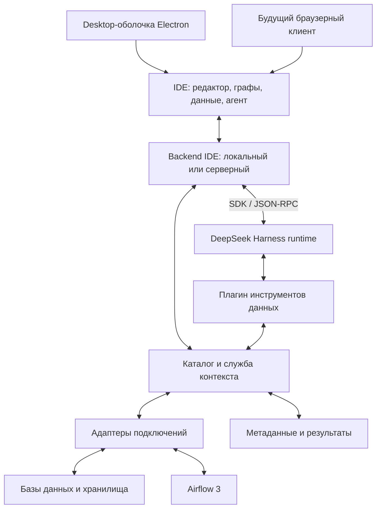

# DBildo — IDE для дата-инженера

Статус: архитектурное предложение от 2026-09-30. Приложение и интеграции пока
не реализованы. Пользователь выбрал: PostgreSQL, ClickHouse, Airflow и официальный
DeepSeek Harness. Функциональная спецификация: [SPEC.md](SPEC.md).
Уточнение: инфраструктура и код создаются с нуля в этом проекте. Первый продукт —
desktop-приложение с возможностью использовать тот же интерфейс в браузере.

## Продукт

Единое рабочее пространство для кода, подключённых данных, пайплайнов и агента
на базе официального DeepSeek Harness. Основной сценарий: открыть проблемный
узел пайплайна, исследовать его данные и зависимости, поручить агенту исправление,
посмотреть diff, выполнить проверку и сравнить результаты.

## Рабочее пространство

- Слева: проект, подключения, каталог таблиц и сохранённые пайплайны.
- В центре: вкладки SQL/Python, граф зависимостей данных и граф выполнения DAG.
- Снизу: результаты SQL, профиль колонок, графики, логи и история запусков.
- Справа: агентная сессия, доступный контекст, вызовы инструментов и изменения.

Выбор таблицы или узла связывает панели: показывает исходный код, схему, примеры
строк, upstream/downstream и последний запуск. Пользователь видит, какие объекты
переданы агенту. Все панели используют идентификаторы одного каталога.

Необходимо различать два графа: зависимости данных (таблицы, модели, колонки)
и зависимости выполнения (задачи, попытки, расписания). Их связывает отношение
«задача читает/создаёт объект данных». Наличие связи выполнения само по себе
не доказывает происхождение данных.

## Компоненты



Предлагаемый стек: Electron для desktop-оболочки, React + TypeScript для интерфейса,
Monaco для кода, React Flow для графов, виртуализированная таблица для результатов.
Локальный Node.js backend управляет TypeScript SDK Harness и подключениями.
SQLite хранит метаданные локального workspace; результаты запросов — отдельные
артефакты с пагинацией. Python-процесс проверяет код DAG в окружении,
соответствующем целевой установке Airflow.
Первый вариант — однопользовательское desktop-приложение. Electron отвечает за
окна, меню, диалоги ОС и запуск backend. React-приложение работает через API и
не импортирует Electron/Node. Это позволяет собрать тот же UI для браузера.

Модули backend первоначально живут в одном приложении. Отдельными процессами
остаются Harness и изолированные проверки Python. Микросервисы и отдельная
графовая БД для первой версии не нужны: связи хранятся в таблице рёбер SQLite.

## Desktop и будущая веб-версия

Electron выбран как предложение для первой реализации: Node.js backend и SDK
Harness уже входят в выбранный стек. Основной процесс оболочки запускает backend
отдельным процессом и отслеживает готовность/завершение. Backend владеет процессом
Harness; renderer не управляет им напрямую. Разделение процессов соответствует
[модели Electron](https://www.electronjs.org/docs/latest/tutorial/process-model).

Общий UI использует HTTP API и SSE в обоих вариантах запуска. В desktop backend
слушает только loopback на выделенном порту; UI получает адрес и сессионный токен
через узкий preload bridge. Backend проверяет токен и origin. Renderer работает
с contextIsolation, sandbox и без nodeIntegration. Bridge предоставляет только
диалоги/сведения о запуске, а не произвольный доступ к ОС.

Доступ к файлам, workspace, credential store и запуску процессов оформляется
backend-интерфейсами. В desktop пути относятся к машине пользователя; в веб-версии —
к workspace сервера. Для браузера нужны импорт/экспорт файлов или подключение Git,
а не попытка использовать локальные пути клиента на сервере.

Переход к веб-версии: самостоятельный запуск backend, сборка общего UI, TLS и
авторизация. Для командного режима дополнительно нужны права на workspace,
изоляция runtime/секретов/процессов, квоты и серверное хранение. Переиспользование
UI не означает, что многопользовательский режим появляется автоматически.

## Окружение с нуля

Предлагается Docker Compose для локального dev-стенда. Приложение подключается
к сервисам как к внешним источникам; Docker нужен для стенда, но не обязателен
для установленной IDE при работе с удалёнными подключениями.

- PostgreSQL с тестовыми исходными данными.
- ClickHouse с целевыми таблицами и витринами.
- Отдельный PostgreSQL для служебной metadata DB Airflow.
- Airflow 3: API server, scheduler с LocalExecutor, DAG processor и triggerer.
- Одноразовая инициализация, health checks и постоянные volumes.

LocalExecutor — проектное решение для небольшого стенда; масштабирование
исполнителей не входит в первый этап. Образы и Python providers закрепляются
точными версиями после smoke-проверки совместимости; `latest` не используется.
Тестовые данные и служебная БД Airflow разделены; metadata DB не индексируется
как пользовательский источник. Официальный
[пример Airflow Docker](https://airflow.apache.org/docs/apache-airflow/3.1.7/howto/docker-compose/index.html)
служит справочником состава сервисов, а не готовым production-развёртыванием.

Исходники DAG и SQL хранятся в `workspace/`. Применение проверенного ChangeSet
создаёт снимок DAG в `runtime/airflow/dags/`, подключённый к контейнерам read-only.
Airflow читает опубликованный снимок, а не незавершённые правки редактора.
После публикации IDE ждёт успешного разбора DAG и сопоставляет revision/hash
со своей записью публикации; точный механизм проверяется на выбранной версии
Airflow. Пока версия не подтверждена, UI не обещает запуск нового кода.

В MVP существует только dev. Production не создаётся автоматически. Позже
публикация снимка заменяется адаптером доставки через Git/CI без изменения UI.

Предлагаемая структура (каталоги ещё не созданы):

```text
apps/desktop/             Electron main и preload
apps/ui/                  общий React-интерфейс
apps/server/              backend для desktop и самостоятельного запуска
packages/contracts/      API, события и схемы валидации
packages/domain/         каталог, запросы, lineage и changesets
packages/connectors/     PostgreSQL, ClickHouse, Airflow 3
packages/harness/        адаптер SDK и плагин данных
infra/dev/               Compose, образы, инициализация, тестовые данные
workspace/dags/           редактируемые Python DAG
workspace/sql/            запросы и преобразования
workspace/tests/          проверки пайплайна и данных
runtime/                  генерируемые снимки, артефакты и служебные файлы
```

`runtime/` и секреты исключаются из Git. Метаданные установленного приложения
и Harness home хранятся в каталоге данных пользователя, отдельно от исходников IDE.

## Интеграция DeepSeek Harness

Использовать официальный runtime через SDK, сохраняя его сессии, цикл агента,
инструменты и события. Runtime работает отдельным процессом; backend владеет
его жизненным циклом. Версии SDK и runtime фиксируются совместно.

Каждый workspace получает явный каталог Harness home. Backend связывает
workspace_id, session_id и права подключений. События преобразуются в стабильный
контракт UI: сообщения, начало/результат инструмента, ошибки, завершение,
запросы взаимодействия. Нужны отмена, восстановление сессии и завершение процесса.

Собственный плагин данных предоставляет агенту те же операции, которыми пользуется
IDE. Детали регистрации плагина и событий проверяются на закреплённой версии SDK
до реализации: Harness находится в developer preview.

## Полный доступ к контексту данных

Полнота означает возможность найти и запросить любой доступный объект, а не
передавать всю базу данных в каждый prompt. Контекст собирается по задаче:

1. Обзор workspace: подключения, каталог, файлы, пайплайны и текущий выбор UI.
2. Описание выбранных объектов: DDL, типы, ключи, описания, зависимости и код.
3. По запросу: выборки, агрегаты, профили, query plan, логи, результаты проверок.
4. Свидетельства: источник, время получения, версия, query/run ID и признак усечения.

Для большого каталога нужны поиск и порционная загрузка. Изменение DDL, кода
или запуска инвалидирует соответствующие снимки. Взаимодействие с UI не должно
незаметно менять контекст уже выполняющегося шага агента: новый выбор применяется
к следующему сообщению или явно добавленному контексту.

Предлагаемые доменные инструменты:

| Инструмент | Назначение |
| --- | --- |
| search_catalog | Поиск таблиц, колонок, моделей и задач |
| describe_asset | Схема, описания, ключи и актуальность объекта |
| get_lineage | Upstream/downstream с источником каждой связи |
| preview_data | Ограниченная выборка с пагинацией |
| execute_query | Выполнение SQL, query ID, результаты и отмена |
| profile_asset | Null, distinct, диапазоны, выборочный или полный профиль |
| inspect_run | Статус, попытки, логи и результаты проверки |
| propose_change | Изменения SQL/Python/DAG как просматриваемый diff |
| validate_change | Проверка синтаксиса и изолированный пробный запуск |

Большие результаты сохраняются как артефакты; агент получает описание, ограниченный
фрагмент и средство дальнейшего чтения. Ключи подключений не становятся частью
контекста модели. Полнота контекста и права изменения — отдельные настройки:
ограничения должны выполняться в адаптере/БД, включая доступ через shell.

## Адаптеры PostgreSQL, ClickHouse и Airflow

Общие операции: проверка подключения, каталог, описание объекта, запрос, отмена,
профиль, состояние операции. Адаптер объявляет capabilities; неподдерживаемые
операции возвращают явную ошибку. Различия диалектов не скрываются за SQL-трансляцией.

| Источник | Метаданные и контекст | Исполнение |
| --- | --- | --- |
| PostgreSQL | Каталоги схем, таблиц, колонок, ключей, индексов, представлений и комментариев | Пул соединений, поток/курсор результатов, параметры, план запроса, отмена и серверный timeout |
| ClickHouse | Таблицы, колонки, движки, partition/order keys, представления | HTTP-клиент, query ID, поток результатов, лимиты, отмена серверного запроса |
| Airflow | DAG, задачи, TaskGroup, запуски, попытки, mapped instances, логи | Public REST API; запуск DAG и clear/retry как отдельные операции с явно указанным охватом |

Airflow — источник истины для состояния выполнения. PostgreSQL/ClickHouse —
для схемы и данных. Репозиторий — для редактируемого SQL/Python. Каталог IDE —
индекс со временем обновления, а не новая копия источников истины.

Для новой инфраструктуры выбирается Airflow 3 и Public API v2. Поддержка Airflow 2
не входит в MVP; при необходимости добавляется отдельный адаптер API v1.
Конкретный релиз и авторизация проверяются при создании стенда. IDE не обращается напрямую
к metadata DB Airflow. [Airflow 2 API](https://airflow.apache.org/docs/apache-airflow/2.10.0/stable-rest-api-ref.html),
[Airflow 3 API](https://airflow.apache.org/docs/apache-airflow/stable/security/api_permissions_ref.html).

Связи «задача → данные» строятся из явных привязок, доступных метаданных
операторов и разбора SQL с учётом диалекта. Позже можно добавить OpenLineage.
Произвольный Python, динамический SQL и шаблоны могут оставлять пробелы: UI
показывает источник связи, её подтверждённость и покрытие. Foreign key — отдельный
вид связи, он не означает движение данных.

Для ClickHouse закрытие клиентского запроса не считается подтверждённой отменой:
адаптер должен проверить завершение операции на сервере и корректно обработать
недостаточные права. Для PostgreSQL read-only транзакция дополняет, но не заменяет
права роли. [ClickHouse HTTP](https://github.com/ClickHouse/clickhouse-docs/blob/main/docs/integrations/interfaces/http.md),
[PostgreSQL transaction modes](https://www.postgresql.org/docs/current/sql-set-transaction.html).

## Прохождение пользовательского запроса

Пример: «Почему загрузка orders из Postgres в ClickHouse упала?»

1. IDE фиксирует выбранные DAG/run/task и версию открытого файла.
2. Context service связывает задачу с входной и выходной таблицами.
3. Harness через инструменты получает лог конкретной попытки, схемы обеих таблиц,
   SQL и ограниченные диагностические выборки.
4. Агент различает факты и гипотезы, прикладывает ссылки на run/query/asset.
5. Изменение сохраняется в ChangeSet с базовым hash файла. Если файл изменился
   параллельно, применение требует разрешения конфликта.
6. Проверка выполняется в тестовом окружении. Публикация файла в среду Airflow
   создаёт отдельный опубликованный снимок; локальное сохранение не равно deploy.
7. Повторный запуск через API отслеживается по новому run ID. Итог сравнивается
   по указанному data interval и проверкам данных, а не только по зелёному статусу.

## Минимальная модель данных

- Workspace и Connection: проект, диалект, возможности адаптера, ссылка на секрет.
- Asset и Column: стабильный ID, полное имя, схема, описание, источник метаданных.
- LineageEdge: источник и получатель, уровень table/column, происхождение связи.
- Pipeline и Task: определение, код, порядок выполнения и связи с Asset.
- Run и TaskAttempt: состояние, интервалы времени, попытки, логи, ошибки.
- QueryResult: SQL, connection ID, схема результата, число строк, усечение, артефакт.
- ContextSnapshot: выбранные объекты, их версии и источники свидетельств.
- AgentSession и ChangeSet: сессия runtime, снимок контекста, diff и проверки.

## Первый вертикальный сценарий

Граница MVP — два SQL-источника (PostgreSQL, ClickHouse), Airflow и один локальный
workspace. Версии стенда фиксируются после проверки совместимости:

1. Подключение к источнику и получение настоящего каталога.
2. Редактор SQL, выполнение/отмена, таблица результата и простой график.
3. Граф зависимостей с переходом от узла к данным и коду.
4. Настоящая сессия Harness, которой доступны каталог и запросы.
5. Поручение агенту исследовать проблему и предложить исправление.
6. Просмотр diff, проверка изменения и повторный запуск.

Если подключений ещё нет, локальный демонстрационный workspace используется
с явной маркировкой. Демонстрационные ответы не выдаются за ответы DeepSeek.

Критерий готовности: пользователь выбирает узел, задаёт вопрос о его данных,
агент получает актуальную схему и выполняет запрос, объясняет результат со ссылкой
на query ID, предлагает изменение, а пользователь видит проверяемый diff.
История сохраняется после перезапуска; ошибки и отмена не оставляют зависшие
запросы или процессы. В MVP не обещается универсальный column-level lineage:
для неподдерживаемого SQL связь отмечается как неизвестная.

## Решения для старта и оставшиеся проверки

- Desktop с первого релиза; общий UI и отдельный backend для будущего веб-режима.
- DAG и SQL в текущем проекте; локальный dev-стенд создаётся через Compose.
- Airflow 3 API v2; совместимость точных версий проверяется в первом этапе.
- По умолчанию планируется официальный DeepSeek endpoint с настраиваемой моделью;
  адрес провайдера вынесен в конфигурацию. Ключ потребуется для живой проверки агента.

Дополнительные ответы пользователя для завершения архитектуры не нужны.
Установка зависимостей, создание стенда и реализация приложения относятся
к следующему этапу, а не к текущей работе над спецификацией.

## Проверенные первичные источники

Проверены 2026-09-30. Выбор UI-библиотек выше — предложение, а не подтверждение
совместимости конкретных версий.

- https://www.deepseek.com/harness/en/ — официальный Harness и статус preview.
- https://github.com/deepseek-ai/deepseek-harness/blob/master/packages/sdk/client/README.md — TypeScript SDK и управление runtime через stdio JSON-RPC.
- https://deepseek-harness.github.io/deepseek-harness/en/reference/ — архитектура, профили, плагины и сессии.
- https://reactflow.dev/learn/concepts/terms-and-definitions — графический UI с узлами и рёбрами.
- https://microsoft.github.io/monaco-editor/ — редактор кода для браузера.
